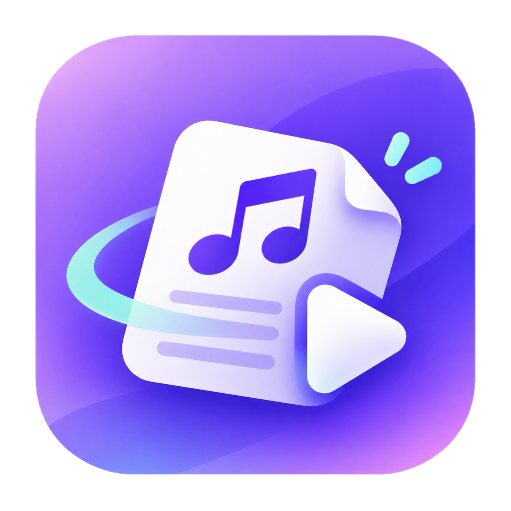

<div align="center">
  
  <h1>ScanScore — Sheet Music Scanner &amp; Player</h1>
  <p>Turn paper sheet music into playable, practiceable, proofreadable digital scores</p>
  <p><a href="README.md">简体中文</a> · <b>English</b></p>
</div>

---

## ✨ Features

- 📷 **Scan**: PNG / JPG / AVIF / WebP / PDF staff-notation scores via offline OMR (Audiveris); low-resolution scans are automatically upscaled; recognition parameters are configurable
- 🎸 **Tablature (TAB)**: tab images are auto-detected and transcribed to alphaTex by a vision model (optional — works with DeepSeek, Zhipu GLM, SiliconFlow, local Ollama or any OpenAI-compatible endpoint); Guitar Pro files (.gp3–.gp5 / .gpx) import natively
- ✏️ **Proofreading editor**: side-by-side original scan & alphaTex with per-measure navigation and scroll sync — fine-tune AI transcriptions by hand
- 🎼 **Library**: SQLite-backed catalog with covers, search & filters, folder import, merging multiple images into one piece, batch recognition / deletion, backup & restore
- ▶️ **Play**: WebAudio synthesizer (GeneralUser GS soundfont), A-B loop, metronome, 0.5–2× speed, track mute, horizontal / page layouts, zoom
- 📤 **Export**: MIDI, MusicXML / alphaTex
- 🔍 **Transparency**: engine logs for every recognition are viewable in the app
- 🔒 **Privacy**: staff-notation recognition runs fully offline; only the optional AI TAB transcription uses the network

## 📦 Download

Grab an installer from [Releases](https://github.com/nova-fable/scan-score/releases):

| Platform | File | Status |
|---|---|---|
| macOS (Apple Silicon) | `ScanScore_x.y.z_aarch64.dmg` | ✅ Working (unsigned — right-click → Open on first launch) |
| Windows | `*.msi` / `*.exe` | 🧪 Experimental (built by CI) |

The Audiveris engine and soundfont are bundled — staff-notation recognition works fully offline. Only "AI TAB transcription" is an optional online feature (bring your own model API key in Settings).

## 🚀 Development

```bash
npm install
npm run dev:app     # run the desktop app in development mode
npm run build:app   # build the release installer
cargo test          # Rust unit tests (run inside src-tauri)
```

Requires the Rust toolchain and Node.js 20+.

### Environment variables (development)

| Variable | Purpose |
|---|---|
| `AUDIVERIS_CMD` | Override the Audiveris launcher path (e.g. `/Applications/Audiveris.app/Contents/MacOS/Audiveris`) |

Settings can also be persisted in the in-app Settings page (stored in the SQLite settings table).

### Release

Version numbers live in three files (package.json / Cargo.toml / tauri.conf.json) — **never edit them by hand**:

```bash
bash scripts/release.sh 0.3.0   # bumps versions → tags → pushes → CI builds the Release
```

In an agent session you can also use `/release 0.3.0` (project skill). See [AGENTS.md](AGENTS.md) for details.

## 🏗 Architecture

```
Import (PDF/PNG/JPG/AVIF/WebP/MusicXML/GP)
  ├─ MusicXML / GP ─────────────────→ library (ready)
  ├─ Tab image (tabdetect) ─────────→ AI transcription via alphaTex → (ready)
  └─ Staff-notation PDF/image ──────→ copy in → recognition queue (serial worker)
        → Audiveris -batch -export → .mxl → unpack → score.xml + metadata → (ready)
  → Library (SQLite) → alphaTab rendering + WebAudio playback
```

Key modules:

| Module | Responsibility |
|---|---|
| `src-tauri/src/omr.rs` | Engine resolution, batch invocation, job queue & cancellation |
| `src-tauri/src/vlm.rs` | AI TAB transcription (OpenAI-compatible protocol, reasoning ladder, retries) |
| `src-tauri/src/tabdetect.rs` | Tab-staff image detection (row-median luminance method) |
| `src-tauri/src/import.rs` | Folder import, vertical image merging, natural sort |
| `src-tauri/src/db.rs` | Library data layer (SQLite) |
| `src-tauri/src/commands.rs` | Tauri commands |
| `src/components/ScoreViewer.tsx` | alphaTab wrapper |
| `src/pages/` | Library / Detail (viewer + proofreading editor) / Settings |

More engineering notes and pitfalls: [AGENTS.md](AGENTS.md).

## 🤝 Contributing

Issues and PRs are welcome — please read [CONTRIBUTING.md](CONTRIBUTING.md) and [AGENTS.md](AGENTS.md) (engineering pitfalls) first.

## 📄 License

- This project: [MIT](LICENSE)
- [Audiveris](https://github.com/Audiveris/audiveris): AGPL-3.0, invoked as a separate process — verify compliance before commercial redistribution
- [alphaTab](https://alphatab.net): MIT
- Soundfonts: GeneralUser GS (by S. Christian Collins, free to redistribute) · SONiVOX EAS (Apache-2.0)
